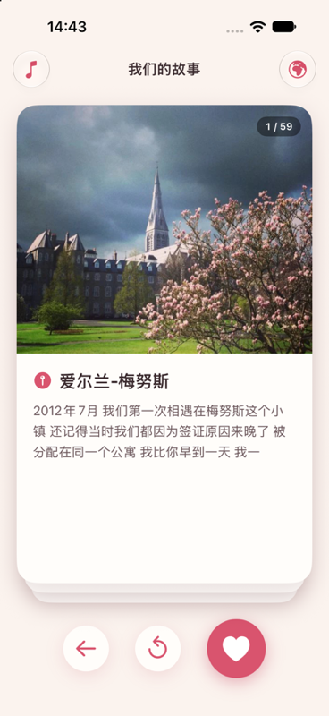
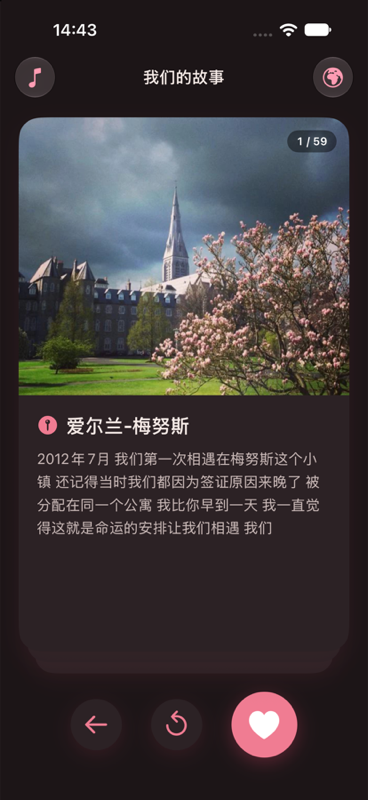
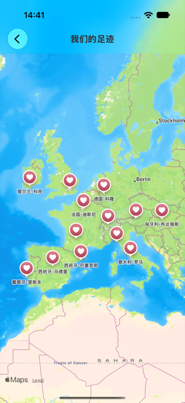

<p align="center"></p>

# OurStories · 我们的故事

A small personal iOS app that keeps our memories: a deck of photo cards, one per
place we have been together, each with a short story that types itself out, and a
map of everywhere those stories happened.

<p align="center">
  
  
  
</p>

## Features

- **Story deck** – swipe a card left or right to move on, or use the buttons:
  back one story, start over, and next (the heart). After the last story the deck
  starts again from the first.
- **Typewriter text** – each story is typed out character by character when its
  card comes to the front.
- **Our footprints (我们的足迹)** – the globe button opens a map with a heart
  marker for every story. It opens on the area where most stories are; pan and
  zoom to find the rest.
- **Background music** – a looping track starts with the app; the music button in
  the top left pauses and resumes it.
- **Light and dark mode** – a warm rose-and-cream palette with a dark variant.

## Requirements

- Xcode 27 or later
- iOS 17 or later (the project uses Xcode's recommended deployment target)
- No third-party dependencies – nothing to install before building

## Getting started

1. Open `OurStories.xcodeproj` in Xcode.
2. Pick an iPhone simulator and press **Run** (⌘R).

From the command line:

```sh
# Build
xcodebuild -project OurStories.xcodeproj -scheme OurStories \
  -destination 'platform=iOS Simulator,name=iPhone 17' build

# Run all tests
xcodebuild -project OurStories.xcodeproj -scheme OurStories \
  -destination 'platform=iOS Simulator,name=iPhone 17' test
```

If `xcodebuild` complains that it needs Xcode, prefix the command with
`DEVELOPER_DIR=/Applications/Xcode.app/Contents/Developer`.

### Running on an iPhone

1. In Xcode, add your Apple ID under **Settings → Accounts**.
2. Select the **OurStories** target → **Signing & Capabilities**, keep
   *Automatically manage signing* on and choose your team. Change the bundle
   identifier (`xiang.our.stories`) if Xcode reports it as taken.
3. Connect the iPhone, trust the Mac, and enable **Developer Mode** on the phone
   (Settings → Privacy & Security → Developer Mode).
4. Choose the phone as the run destination and press **Run**.
5. With a free Apple ID, trust the developer on the phone under
   Settings → General → VPN & Device Management.

The app uses no permission-protected features, so no privacy prompts appear.

## Adding or editing a story

All content lives in one place: the array returned by `Story.storyGenerate()` in
`OurStories/Model/Story.swift`. Cards appear in array order, and the map gets its
markers from the same array.

```swift
Story(location: "爱尔兰-梅努斯",
      date: StoryDate(year: 2012, month: 7),
      storyContent: "我们第一次相遇在梅努斯这个小镇 ...",
      imageName: "ireland-maynooth",
      coordinate: CLLocationCoordinate2D(latitude: 53.381210, longitude: -6.592220)),
```

- `date` is shown as a badge on the photo (`2012年7月`) and under the place name on
  the map. Add `day:` when the exact day matters (`2021年7月7日`), or leave `date`
  out and the badge is hidden. Keep the date out of `storyContent`.
- `imageName` is the name of an image set in `Assets.xcassets`. Image sets are
  named after the place, `country-place` in lowercase English
  (`ireland-maynooth`), with the year added when a place comes back
  (`france-paris-2023`). To add a photo, create a new image set named that way
  and drop the picture in.
- In `storyContent`, a `$` is never shown: it makes the typewriter pause for one
  beat. Use several for a longer pause.
- Several later stories still use placeholder text (`测试段落…`) and reuse the
  first photos; they are waiting for their real words and pictures.

The unit tests check that every story has text, a valid coordinate and an image
that exists, so run them after editing.

## Project structure

```
OurStories/
  AppDelegate.swift, SceneDelegate.swift   app start-up, builds the window in code
  Controllers/
    MainViewController.swift               story deck, buttons, music toggle
    MapViewController.swift                map with one marker per story
  View/
    CardDeckView.swift                     swipeable card stack
    CardView.swift                         one story card
  Model/
    Story.swift                            all the stories
    VisitPlace.swift                       map annotation
  Utils/                                   colours, layout helper, typewriter text view, music
  Resources/jay.mp3                        background music
  Assets.xcassets                          photos and app icon
OurStoriesTests/                           unit tests (stories, typewriter, deck)
OurStoriesUITests/                         UI tests (walk the deck, open the map)
scripts/make-icon.swift                    draws the app icon
docs/                                      screenshots used in this README
```

The interface is built entirely in code with UIKit; the only storyboard is the
launch screen. Colours are defined once in `Utils/UIColor+Helper.swift`.

## App icon

The icon is drawn by a script. To change it, edit `scripts/make-icon.swift` and
run:

```sh
swift scripts/make-icon.swift icon.png
```

Then replace `OurStories/Assets.xcassets/AppIcon.appiconset/AppIcon.png` with the
result. App icons must not have transparency, so flatten the PNG first (for
example by exporting it from Preview with *Alpha* unticked).

## Tests

- **Unit tests** – story data, the typewriter's `$` pause and space handling, and
  the card deck's next / previous / start-over logic.
- **UI tests** – launch the app, move through cards with the buttons and a swipe,
  open the map, and check that the deck starts over after the last story.

## History

Written in 2019 and brought up to date in 2026: CocoaPods and the Koloda and
PopupDialog libraries were replaced with native code, the app moved to the modern
scene lifecycle, and the interface was redesigned.
